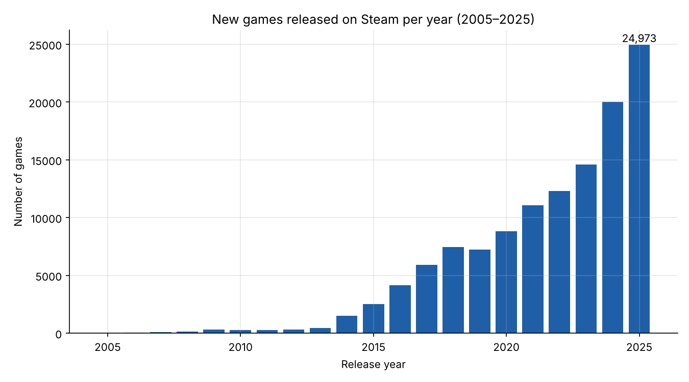
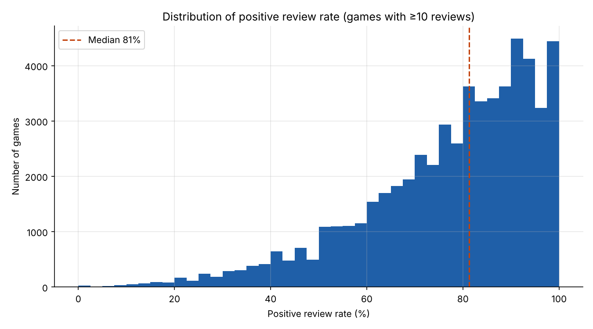
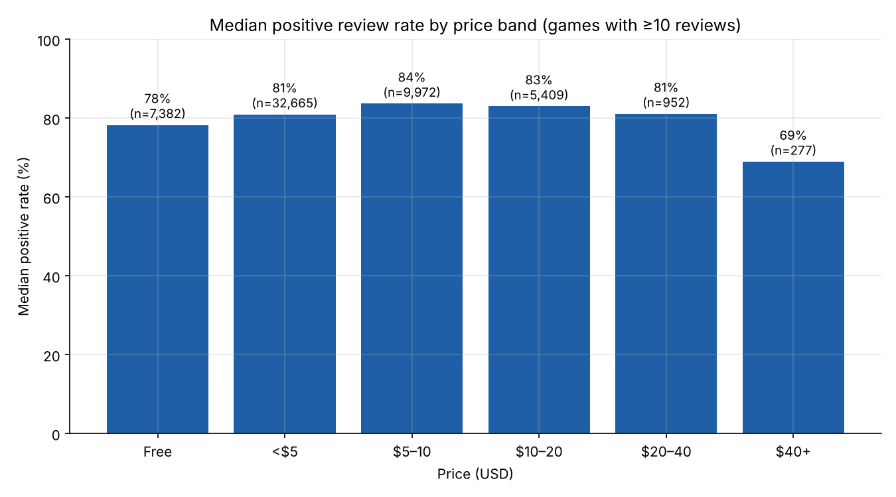
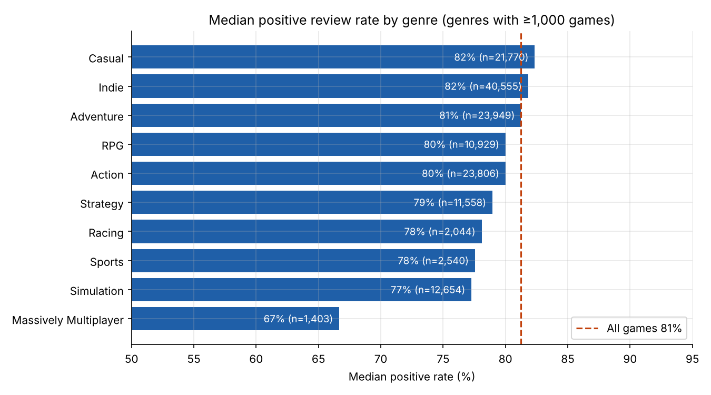
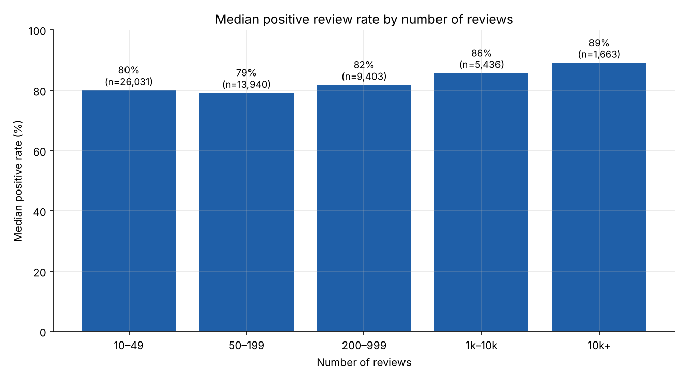
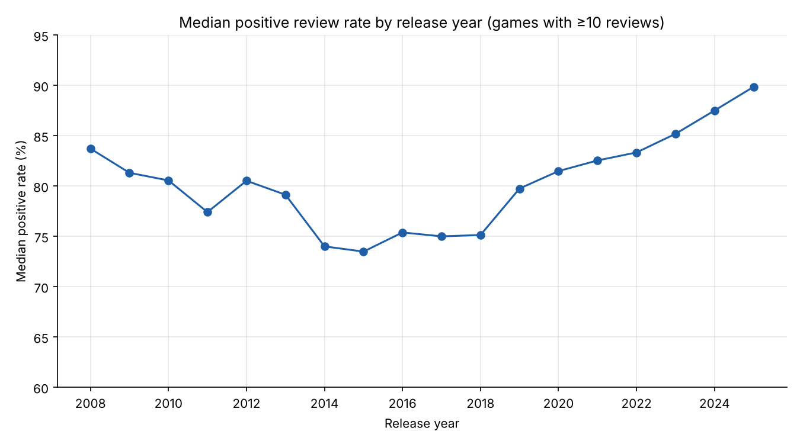
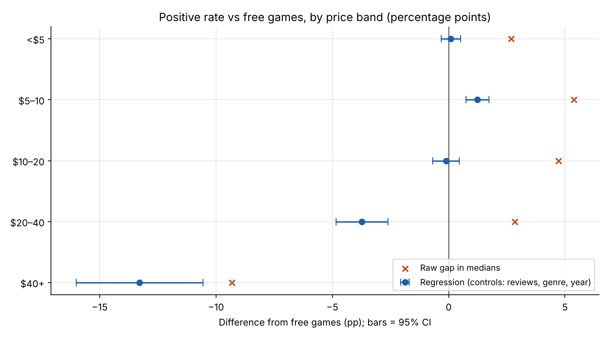

# Steam Games Data Analysis

What drives the reception of games on Steam? This project explores ~124,000 Steam games with Python (pandas, matplotlib).

> **Status:** Phase 1 (data cleaning + exploratory analysis) and Phase 2 (factors behind positive review rate, regression) complete. Final write-up in progress.

| Notebook | What it covers |
|---|---|
| [`steam_analysis_phase1.ipynb`](steam_analysis_phase1.ipynb) | Cleaning, release trends, genres, rating distribution, price bands |
| [`steam_analysis_phase2.ipynb`](steam_analysis_phase2.ipynb) | Rating by genre / popularity / year; multiple linear regression on price |

## Data

[FronkonGames Steam Games Dataset](https://huggingface.co/datasets/FronkonGames/steam-games-dataset) (MIT licence) — 124,146 games, 41 columns, snapshot up to September 2026.

The data file is not in this repository (it is ~190 MB). To run the notebook, download `data/train-00000-of-00001.parquet` from the link above and save it as `data/games.parquet`.

## Phase 1 findings

| | |
|---|---|
|  |  |
|  |  |

1. **Release volume has exploded.** 24,973 games were released in 2025, about 10× the 2015 figure; 74% of all games on Steam came out in 2020–2025.
2. **Indie dominates.** 66% of games carry the Indie genre tag.
3. **Most games are barely reviewed.** 33% have no reviews at all; only 46% have 10 or more. Among those, the median positive review rate is 81%.
4. **Price is not "the more expensive, the better".** Games priced $5–20 have the highest median positive rate (83–84%); free games (78%) and games over $40 (69%) score lower.

## Phase 2 findings

Sample: 56,473 games with ≥10 reviews released 2008–2025.

| | |
|---|---|
|  |  |
|  |  |

1. **Genre matters.** Casual and Indie games have the highest median positive rate (82%); Massively Multiplayer games the lowest (67%). Holding price, popularity and year constant, the MMO tag is still associated with −12 percentage points.
2. **Popular games are rated higher.** Every 10× increase in review count is associated with +5 percentage points in positive rate (games with 10k+ reviews: median 89%).
3. **Recent games score higher.** Games released 2014–2018 have the lowest median (73–75%), rising to 90% for 2025 — but recent games' reviews are still accumulating, so this may partly fade.
4. **The high-price penalty survives the controls — and grows.** A multiple linear regression (price band, log review count, 10 genre flags, release year; HC1 robust standard errors) shows price bands under $20 within about 1 pp of free games, while **games over $40 score about 13 pp lower** (95% CI −16 to −11), larger than the 9-point raw gap.

Limitations: R² is 0.16, so most variation in reception comes from things not in the data (such as game quality); the regression shows association, not causation.

## Cleaning steps

- Removed one game with an empty name; checked `appID` for duplicates (none).
- Parsed `release_date` text into dates and extracted the year.
- Split `estimated_owners` ranges (e.g. `"20000 - 50000"`) into numeric lower/upper bounds.
- Computed `total_reviews` and `positive_rate`; games with no reviews get a missing rate rather than 0.
- Rating analyses use only games with at least 10 reviews, since rates from 1–2 reviews are mostly 0% or 100%.

## Run it

```bash
pip install -r requirements.txt
jupyter notebook
```
