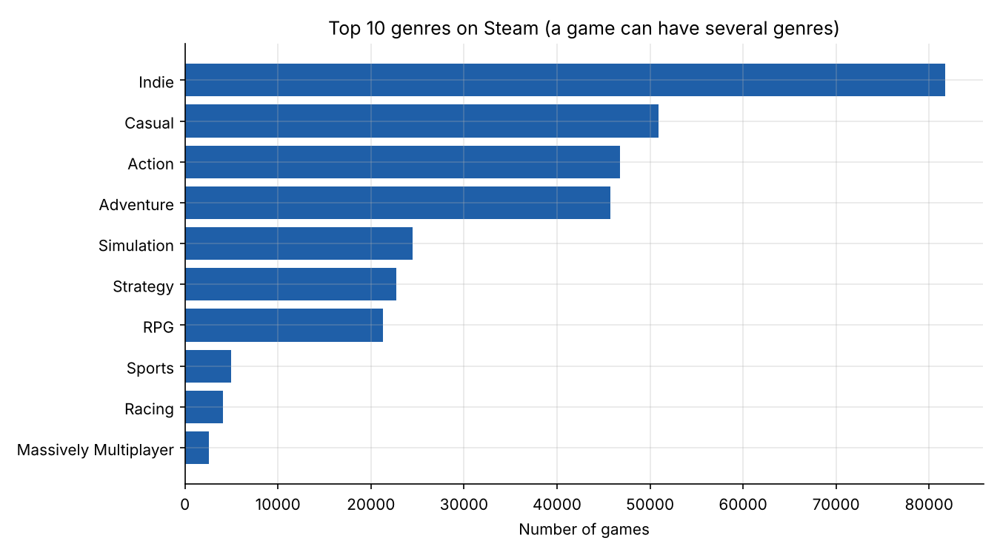

# Steam Games Data Analysis

What drives the reception of games on Steam? This project explores ~124,000 Steam games with Python (pandas, matplotlib).

> **Status:** Phase 1 complete (data cleaning + exploratory analysis). Phase 2 (factors behind positive review rate) in progress.

## Data

[FronkonGames Steam Games Dataset](https://huggingface.co/datasets/FronkonGames/steam-games-dataset) (MIT licence) — 124,146 games, 41 columns, snapshot up to September 2026.

The data file is not in this repository (it is ~190 MB). To run the notebook, download `data/train-00000-of-00001.parquet` from the link above and save it as `data/games.parquet`.

## Phase 1 findings

| | |
|---|---|
|  |  |
|  |  |

1. **Release volume has exploded.** 24,973 games were released in 2025, about 10× the 2015 figure; 74% of all games on Steam came out in 2020–2025.
2. **Indie dominates.** 66% of games carry the Indie genre tag.
3. **Most games are barely reviewed.** 33% have no reviews at all; only 46% have 10 or more. Among those, the median positive review rate is 81%.
4. **Price is not "the more expensive, the better".** Games priced $5–20 have the highest median positive rate (83–84%); free games (78%) and games over $40 (69%) score lower.

## Cleaning steps

- Removed one game with an empty name; checked `appID` for duplicates (none).
- Parsed `release_date` text into dates and extracted the year.
- Split `estimated_owners` ranges (e.g. `"20000 - 50000"`) into numeric lower/upper bounds.
- Computed `total_reviews` and `positive_rate`; games with no reviews get a missing rate rather than 0.
- Rating analyses use only games with at least 10 reviews, since rates from 1–2 reviews are mostly 0% or 100%.

## Run it

```bash
pip install -r requirements.txt
jupyter notebook steam_analysis_phase1.ipynb
```
